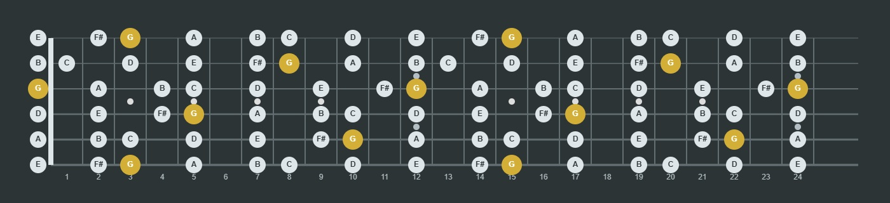
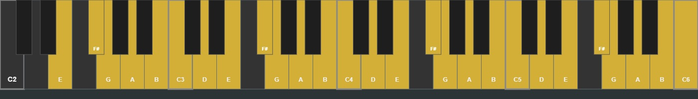
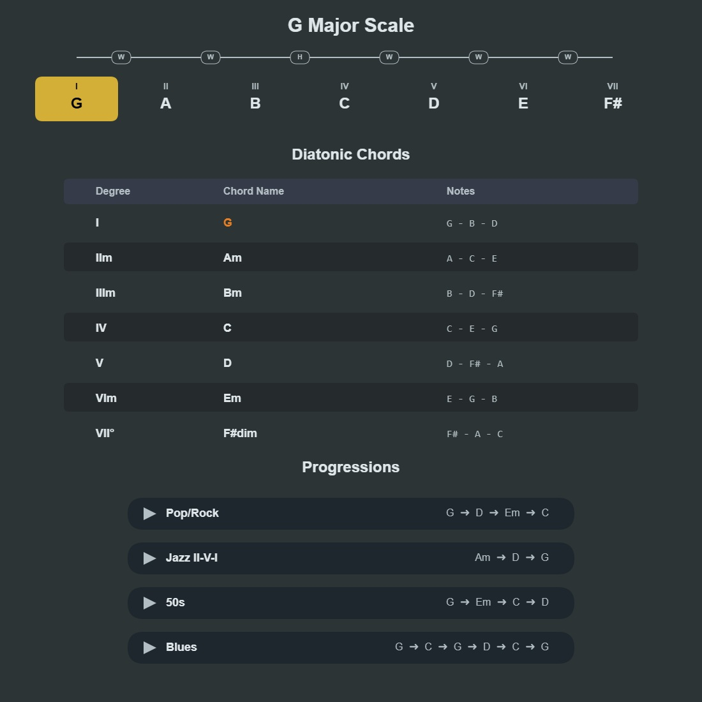
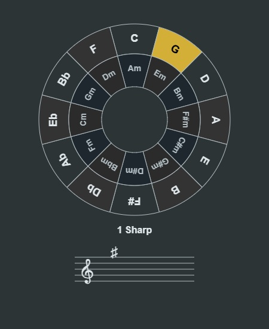
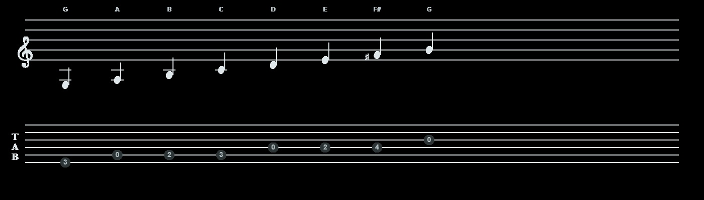

# **Tara \- GuitarLab 🎸🎹**

**Tara GuitarLab** is an advanced, interactive laboratory for visualizing music theory, scales, chords, and their relationships across multiple instruments (Guitar & Piano) right in your browser.  
[*برای مطالعه توضیحات فارسی به پایین صفحه مراجعه کنید 🇮🇷*](#توضیحات-فارسی)  
🔗 [**Live Demo / اجرای آنلاین**](https://soroush-zendedel.github.io/tara/)

**Current release:** `v1.0.0` · [What's new](https://soroush-zendedel.github.io/tara/#release-notes) · [Changelog](CHANGELOG.md)

## **✨ Features**

* **Interactive Fretboard:** Visualize any scale or chord across the entire guitar fretboard. Toggle between different CAGED positions and highlight octaves.  
* **Circle of Fifths:** An interactive circle to instantly select Major and relative Minor keys.  
* **Music Theory & Progressions:** Auto-generates scale degrees, diatonic chords, and common chord progressions (Pop, Jazz, Blues, etc.) for the selected key.  
* **Piano Reference:** Direct visual connection between the guitar fretboard and piano keys.  
* **Standard Notation & Tablature:** Automatically generates sheet music and guitar TABs for the selected scale or chord voicings.  
* **Built-in Audio Synthesizer:** Click on any note or chord on the fretboard, theory chart, or piano to hear its precise synthesized audio.  
* **Chromatic Tuner:** Built-in guitar tuner using your device's microphone (Web Audio API).  
* **Smart Metronome:** Adjustable BPM with visual and audio feedback.  
* **PDF Export:** Generate and download a comprehensive PDF booklet of your current scales and charts with a single click.  
* **Interactive Practice:** Try note-finding, scale-building, interval, chord, ear-training, and microphone exercises; includes 20 guided lessons linked to the app's tools and locally saved progress.
* **Teacher Notes:** Mark and label notes on the guitar or piano, play the selection in order, step through it, and undo or redo edits.
* **Live Input:** Play notes with computer keys or a connected MIDI keyboard; use keyboard shortcuts for scales, chords, fretboard positions, and tempo.
* **Customizable Workspace:** Hide or restore learning, theory, notation, fretboard, and piano sections; preferences persist on the current device.
* **Mobile Instrument View:** Open instrument and theory diagrams in an immersive view with landscape orientation support and readable, scrollable detail.
* **Dark/Light Theme:** Fully responsive UI with seamless theme switching.

## **📸 Screenshots**

### **The Fretboard & Piano Connection**




### **Music Theory & Diatonic Chords**



### **Interactive Circle of Fifths**



### **Auto-Generated Notation & Tabs**



## **🚀 Quick Start (Local Setup)**

The finished site uses **HTML, CSS, and vanilla JavaScript**. Running it does not require Node.js, npm, pnpm, or a build step. Python is used below only to serve the files locally.

1. Clone the repository:  
   git clone https://github.com/soroush-zendedel/tara.git

2. Navigate to the project directory:  
   cd tara

3. Start a local static server from the repository root:
   ```bash
   python -m http.server 8000
   ```
4. Open `http://localhost:8000/` for the English landing page, `http://localhost:8000/fa/` for the Persian landing page, `http://localhost:8000/about.html` or `http://localhost:8000/fa/about.html` for the About pages, `http://localhost:8000/app.html` for GuitarLab, or `http://localhost:8000/book.html` for the flipbook editor.
   *The tuner requires HTTPS or localhost so the browser can request microphone access.*

All runtime styles, fonts, icons, images, and JavaScript libraries are included in this repository. After you have the project files, the pages and app work without an internet connection; only external links such as GitHub require a connection when opened. Third-party asset licenses are included in `assets/licenses/`. Use the local server above rather than opening the HTML files directly, so browser features such as local assets and microphone access work reliably.

The Persian and English landing and About pages are independent HTML documents. The app is split into ordinary HTML, CSS, and ordered browser JavaScript files under `assets/`. The generated landing-page Tailwind stylesheet is checked in at `assets/css/tailwind.min.css`; its source and configuration are `assets/css/tailwind-input.css` and `tailwind.config.cjs`.

### Run and develop with Docker Compose

Install Docker Desktop or Docker Engine with Compose v2, then run this from the project root:

```bash
docker compose up --build -d
```

Open `http://localhost:8001/` (or `/fa/`, `/about.html`, `/fa/about.html`, and `/app.html`). The service is named `site`, but it is the only default service, so there is no need to add its name to the command. `--build` is accepted for the usual Compose workflow; this static site has no custom image build, so Docker runs the prebuilt Nginx image and serves the project files mounted read-only. Edits to HTML, CSS, JavaScript, and images appear after refreshing the browser. Stop the service with `docker compose down`; view its output with `docker compose logs -f site`.

If port 8001 is already in use, set a different host port before starting Compose, for example in PowerShell: `$env:TARA_PORT = "8002"`, then run `docker compose up --build -d` and open `http://localhost:8002/`. Tailwind class changes still need the CSS build described below; the updated stylesheet is served as soon as it is rebuilt. The first Compose run needs the `nginx:alpine` image available and may download it; to prepare for later offline use, run `docker compose pull site` while connected.

### Style and site development

You do **not** need npm or pnpm for ordinary content changes, edits to `assets/css/landing.css`, `assets/css/about.css`, or `assets/css/app.css`, or for running the site. Edit those files and refresh the local page.

The landing pages also use Tailwind utility classes in `index.html` and `fa/index.html`. If you add, remove, or change one of those classes, install the development dependency once and rebuild the checked-in stylesheet:

```bash
pnpm install
pnpm run build:css
```

Alternatively, with npm:

```bash
npm install
npm run build:css
```

To rebuild automatically while editing Tailwind classes, use `pnpm run watch:css` (or `npm run watch:css`) in a second terminal. Keep `assets/css/tailwind.min.css` in the change/commit so the published site does not need Node.js or a build step. After rebuilding, run the local server from the project root as described above and check both `/` and `/fa/` at desktop and mobile widths. The app's styling is ordinary CSS in `assets/css/app.css`; it does not use Tailwind.

## **🛠️ Tech Stack**

* **Core:** HTML5, CSS3, Vanilla JavaScript (ES6+)  
* **Graphics & Rendering:** HTML5 \<canvas\> API  
* **Audio & Tuning:** Web Audio API (AudioContext, AnalyserNode)  
* **Export:** [jsPDF](https://github.com/parallax/jsPDF)  
* **Landing Page UI:** Tailwind CSS

## **🤝 Contributing**

Contributions, issues, and feature requests are welcome\!  
Feel free to check the [issues page](https://github.com/soroush-zendedel/tara/issues).

1. Fork the Project  
2. Create your Feature Branch (git checkout \-b feature/AmazingFeature)  
3. Commit your Changes (git commit \-m 'Add some AmazingFeature')  
4. Push to the Branch (git push origin feature/AmazingFeature)  
5. Open a Pull Request

## **📄 License**

Distributed under the MIT License. See LICENSE for more information.

## **توضیحات فارسی**

**تارا گیتارلب (Tara GuitarLab)** یک آزمایشگاه تعاملی و پیشرفته برای تجسم تئوری موسیقی، گام‌ها، آکوردها و ارتباط آن‌ها روی سازهای مختلف (گیتار و پیانو) است که مستقیماً در مرورگر شما اجرا می‌شود.

### **🌟 امکانات کلیدی**

* **فرت‌بورد تعاملی (دسته گیتار):** نمایش کامل گام‌ها و آکوردها روی دسته گیتار با قابلیت فیلتر کردن پوزیشن‌ها (CAGED) و نمایش اکتاوها.  
* **دایره پنجم‌ها:** انتخاب سریع گام‌های ماژور و مینور نسبی و مشاهده سرکلیدها.  
* **تئوری و توالی آکوردها:** محاسبه خودکار درجات گام، آکوردهای دیاتونیک و توالی‌های معروف (پاپ، جز، بلوز و...).  
* **تطبیق با پیانو:** نمایش همزمان نت‌های انتخاب شده روی کلاویه‌های پیانو برای درک بهتر فواصل.  
* **نت‌نویسی و تبلچر (TAB):** رسم خودکار نت‌ها روی خطوط حامل استاندارد و تبلچر گیتار.  
* **پخش صوتی دقیق:** امکان کلیک روی هر نت یا آکورد در تمام بخش‌های برنامه برای شنیدن صدای آن (تولید شده توسط سینتی‌سایزر داخلی).  
* **تیونر کروماتیک:** کوک کردن گیتار از طریق میکروفون دستگاه با دقت بالا.  
* **مترونوم هوشمند:** دارای بازخورد دیداری و شنیداری با قابلیت تنظیم تمپو.  
* **خروجی PDF جزوه:** ذخیره تمام نمودارها و آموزش‌های روی صفحه در قالب یک فایل PDF با یک کلیک.  
* **تمرین تعاملی:** تمرین دسته، ساخت گام، آکوردهای دیاتونیک، تشخیص شنیداری، تمرین با میکروفون و درس‌های کوتاه همراه توضیح پاسخ و ذخیره‌ی محلی پیشرفت.
* **ابزار مدرس:** علامت‌گذاری و نام‌گذاری نت‌ها روی گیتار یا پیانو، پخش ترتیبی، حرکت بین نت‌ها و بازگردانی تغییرها.
* **ورودی زنده:** نواختن نت‌ها با صفحه‌کلید کامپیوتر یا کیبورد MIDI و استفاده از میانبرها برای انتخاب گام، آکورد، پوزیشن و تمپو.
* **تم تاریک/روشن:** رابط کاربری مدرن و سازگار با انواع صفحات نمایش.

### **⚙️ نحوه اجرا (اجرای محلی)**

برای اجرای نسخهٔ آماده به Node.js، npm، pnpm یا فرایند build نیازی نیست. Python فقط برای اجرای سرور محلی در دستور زیر استفاده می‌شود:

۱. مخزن را کلون کنید:  
git clone https://github.com/soroush-zendedel/tara.git

۲. از ریشه پروژه یک سرور محلی اجرا کنید:
```bash
python -m http.server 8000
```
۳. صفحه فرود انگلیسی را در `http://localhost:8000/`، صفحه فارسی را در `http://localhost:8000/fa/` یا برنامه را در `http://localhost:8000/app.html` باز کنید.
*(برای دسترسی تیونر به میکروفون، HTTPS یا localhost لازم است.)*

### اجرا و توسعه با Docker Compose

Docker Desktop یا Docker Engine به‌همراه Compose نسخهٔ ۲ را نصب کنید و از ریشهٔ پروژه اجرا کنید:

```bash
docker compose up --build -d
```

سپس `http://localhost:8001/` را باز کنید (یا مسیرهای `/fa/`، `/about.html`، `/fa/about.html` و `/app.html`). سرویس `site` تنها سرویس پیش‌فرض Compose است و لازم نیست نامش را به دستور اضافه کنید. گزینهٔ `--build` با این فرمان کار می‌کند، اما سایت ایستا image اختصاصی برای build ندارد؛ Docker از image آمادهٔ Nginx استفاده می‌کند و فایل‌های پروژه را فقط‌خواندنی در آن mount می‌کند. تغییر HTML، CSS، جاوااسکریپت یا تصویر با تازه‌کردن مرورگر دیده می‌شود. برای توقف سرویس `docker compose down` و برای مشاهدهٔ خروجی `docker compose logs -f site` را اجرا کنید.

اگر پورت ۸۰۰۱ اشغال است، پیش از اجرا پورت دیگری تعیین کنید؛ در PowerShell:

```powershell
$env:TARA_PORT = "8002"
docker compose up --build -d
```

بعد `http://localhost:8002/` را باز کنید. تغییر کلاس‌های Tailwind همچنان به build CSS طبق بخش بعد نیاز دارد و خروجی به‌محض تولید از طریق Compose در دسترس خواهد بود. بار اول باید imageِ `nginx:alpine` دریافت شود؛ برای اجرای آفلاین بعدی، وقتی اینترنت دارید `docker compose pull site` را اجرا کنید.

### توسعه و تغییر ظاهر

برای تغییر متن‌ها یا ویرایش CSS معمولی، فایل مربوط را مستقیماً تغییر دهید؛ برای این کار به npm یا pnpm نیازی نیست. استایل صفحهٔ اصلی و فارسی در `assets/css/landing.css`، صفحه‌های درباره در `assets/css/about.css` و برنامه در `assets/css/app.css` است.

صفحه‌های فرود از کلاس‌های Tailwind در `index.html` و `fa/index.html` هم استفاده می‌کنند. اگر کلاس Tailwind اضافه، حذف یا عوض کردید، یک‌بار وابستگی توسعه را نصب و CSS نهایی را دوباره تولید کنید:

```bash
pnpm install
pnpm run build:css
```

یا با npm:

```bash
npm install
npm run build:css
```

برای تولید خودکار هنگام ویرایش کلاس‌ها، `pnpm run watch:css` یا `npm run watch:css` را در یک ترمینال دیگر اجرا کنید. فایل تولیدشدهٔ `assets/css/tailwind.min.css` را همراه تغییرات نگه دارید تا سایت منتشرشده برای اجرا به Node.js یا build نیاز نداشته باشد. سپس با سرور محلی بالا، صفحه‌های `/` و `/fa/` را در اندازهٔ دسکتاپ و موبایل بررسی کنید. ظاهر برنامه Tailwind ندارد و با CSS معمولی در `assets/css/app.css` مدیریت می‌شود.
